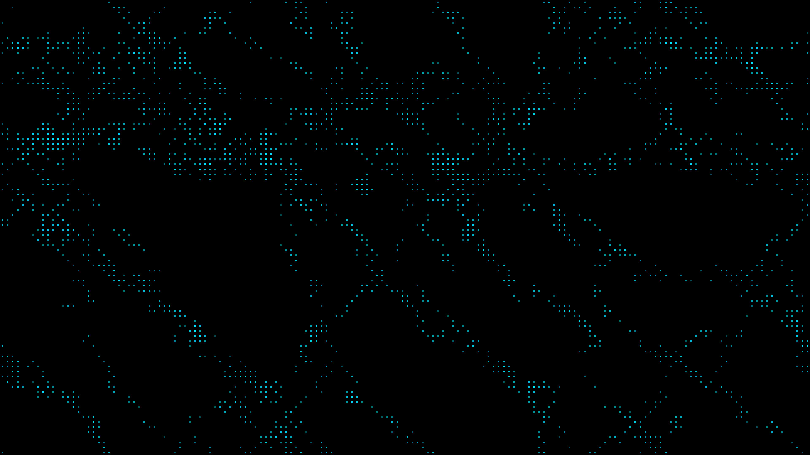
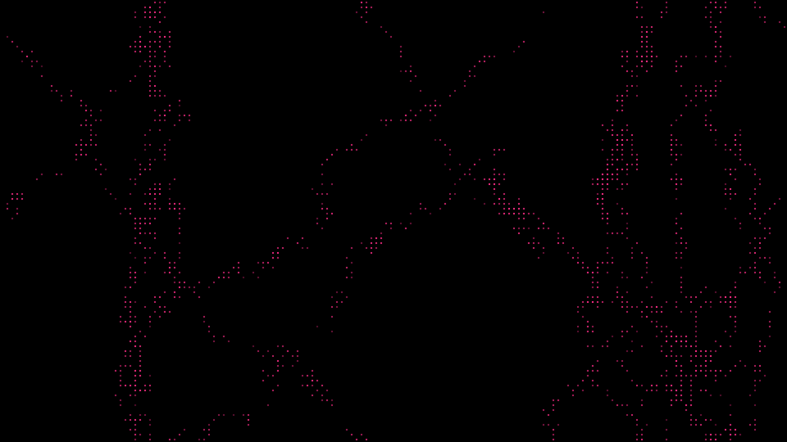
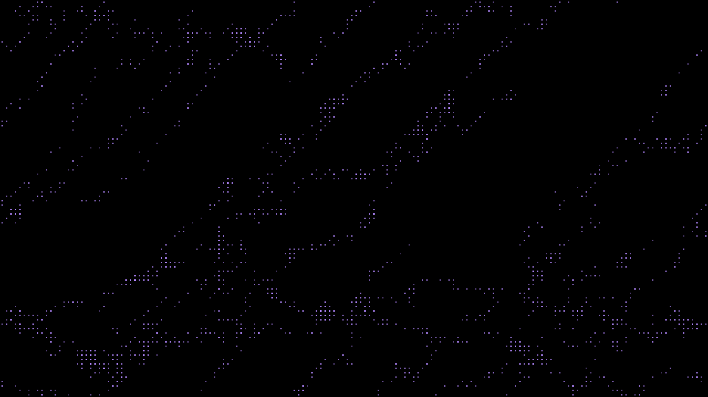

# pixels wallpaper

Pseudo-random pixel art wallpaper generator. It outputs 8K (4320 px height) images in several aspect ratios, with full control over dot color, density and shading.

The same seed and settings always produce the same image. Every value is written in the file name, so you can regenerate any wallpaper you like.

## Gallery

Six random-seed demos (1920×1080 previews). Each file name holds the values used to generate it.

| Preview | Seed | Color |
|---|---|---|
|  | 602 | `#39FF14` |
|  | 452 | `#FF6A00` |
|  | 211 | `#00E5FF` |
|  | 448 | `#FF2E88` |
|  | 317 | `#FFD400` |
|  | 552 | `#B388FF` |

All six use the default settings: 16:9, padding 8, density 0.55, shading min 0.45 and max 1.0.

## Requirements

- Python 3.10 or newer
- [NumPy](https://numpy.org/)
- [Pillow](https://python-pillow.org/)

```bash
pip install numpy pillow
```

## Quick start

```bash
# Easiest way: an interactive menu where you can change everything
python3 wallpaper_generator.py -i

# One solid color
python3 wallpaper_generator.py --seed 6 --color "#39FF14"
```

The seed and a color (or `--rainbow`) are the only required values. Everything else has a default.

## Color modes

There are three ways to color the dots.

### 1. Solid color

```bash
python3 wallpaper_generator.py --seed 6 --color "#FF6A00"
```

### 2. Blend of 2 to 4 colors

Give the colors separated by commas. Each color is placed at a random point of the image and the colors blend smoothly between those points. The positions come from `--color-seed` (by default, the same as `--seed`), so you can move the colors around without changing where the dots are.

```bash
python3 wallpaper_generator.py --seed 6 --color "#FF2E88,#00E5FF,#FFD400" --color-seed 3
```

### 3. Rainbow

The hue follows a gradient across the image. The start hue and the direction come from the seed, so every seed looks different. By default the gradient covers 75 % of the hue circle, so it does not loop back to its first color.

```bash
python3 wallpaper_generator.py --seed 6 --rainbow

# Set the gradient by hand
python3 wallpaper_generator.py --seed 6 --rainbow --hue-start 200 --hue-angle 45 --hue-span 0.6
```

## Interactive menu

`python3 wallpaper_generator.py -i` opens a menu. Every setting can be changed there, and the final file name is shown live, so you always see what will be saved.

```
--- Current settings ---
  1) Seed         : 6
  2) Color(s)     : #FF2E88,#00E5FF
  3) Color details: color seed 3
  4) Format       : 16:9  (7680 x 4320)
  5) Padding      : 8
  6) Density      : 0.55
  7) Shading      : min 0.45  max 1
  8) Output folder: output
  File name       : pixels_wallpaper_8K_16-9_seed6_hexFF2E88-00E5FF_cseed3_density0.55_min0.45_max1_padding8.png
  p) Preview in terminal (saves nothing)
  g) Generate with these settings
  q) Quit without generating
```

Option 3 adapts to the color mode: the color seed for a blend, or the start hue, span and direction for rainbow. Use `p` to preview in the terminal before generating.

## Options

| Option | Default | Description |
|---|---|---|
| `--seed N` | required | Non-negative integer. Decides where the dots are. |
| `--color HEX` | required | `#39FF14`, or 2 to 4 hex colors separated by commas, or `rainbow`. |
| `--rainbow` | off | Same as `--color rainbow`. |
| `--color-seed N` | same as `--seed` | Blend mode: where each color sits. Moves colors without moving dots. |
| `--hue-start DEG` | from seed | Rainbow: starting hue, 0 to 360. |
| `--hue-span X` | `0.75` | Rainbow: share of the hue circle covered, 0.1 to 1.0. At 1.0 it loops back to the first color. |
| `--hue-angle DEG` | from seed | Rainbow: gradient direction. 0 = left to right, 90 = top to bottom. |
| `--format R` | `16:9` | `16:9`, `16:10`, `21:9`, `32:9`, `4:3`, `3:2` or `1:1`. All have 8K height (4320 px). |
| `--padding N` | `8` | Gap inside each cell, 0 to 11. |
| `--density X` | `0.55` | How many dots appear, 0.05 to 1.0. Higher means more dots. |
| `--shade-min X` | `0.45` | Brightness at group edges, 0 to 1. |
| `--shade-max X` | `1.0` | Brightness at group centers, 0 to 1. |
| `--output DIR` | `output/` | Output folder. |
| `--preview` | off | Draw the result in the terminal (needs 24-bit color). Saves nothing. |
| `-i`, `--interactive` | off | Menu to set everything before generating. |

Changing `--density` also changes the shape of the groups for the same seed, because the seed decides the walkers' steps and the density decides which steps light a dot.

## File names

The file name holds every value needed to reproduce the image, with no timestamp. Values that would otherwise come from the seed (rainbow start and direction, color seed) are written out in full.

```
pixels_wallpaper_8K_<format>_seed<N>_<color part>_density<X>_min<X>_max<X>_padding<N>.png
```

| Mode | Color part | Example |
|---|---|---|
| Solid | `hex<RRGGBB>` | `hex39FF14` |
| Blend | `hex<A>-<B>[-<C>-<D>]_cseed<N>` | `hexFF2E88-00E5FF-FFD400_cseed3` |
| Rainbow | `rainbow-start<DEG>-span<X>-angle<DEG>` | `rainbow-start204.5-span0.75-angle226.9` |

Full example:

```
pixels_wallpaper_8K_16-9_seed6_rainbow-start204.5-span0.75-angle226.9_density0.55_min0.45_max1_padding8.png
```

To regenerate it, pass those same values:

```bash
python3 wallpaper_generator.py --seed 6 --rainbow --hue-start 204.5 --hue-span 0.75 --hue-angle 226.9
```

## How it works

1. Walkers seeded from your number move across a grid of 48 px cells and light the cells they step on.
2. Each dot is drawn as a square smaller than its cell. The gap between dots is the padding.
3. Each dot's brightness depends on how many of its eight neighbors are lit. Group centers are brightest and edges dim, with some random variation per dot.
4. Each dot's color comes from the color mode: one fixed color, a smooth blend between randomly placed colors, or a rainbow gradient. Colors use their own random generators, so changing them never moves the dots.

## License

- **Code:** [PolyForm Noncommercial 1.0.0](LICENSE). Free to use, copy, modify and share, but not for commercial purposes.
- **Generated images and artwork:** [Creative Commons BY-NC-SA 4.0](https://creativecommons.org/licenses/by-nc-sa/4.0/). Credit the author, don't use commercially, and share derivatives under the same license.
