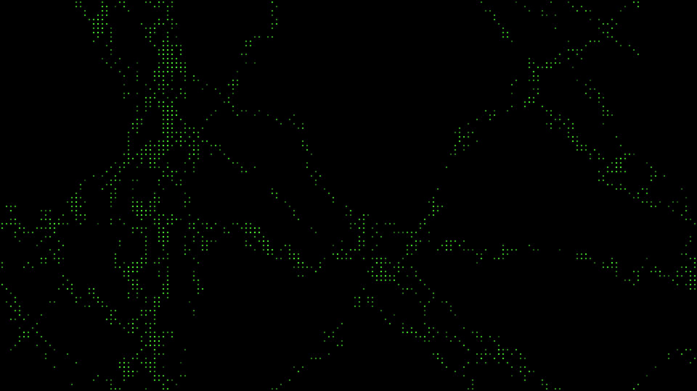
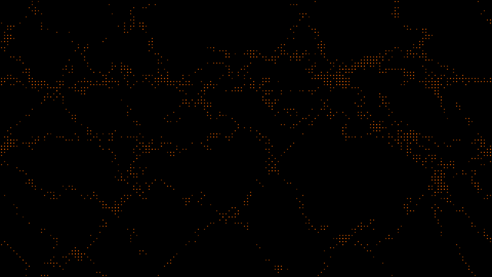
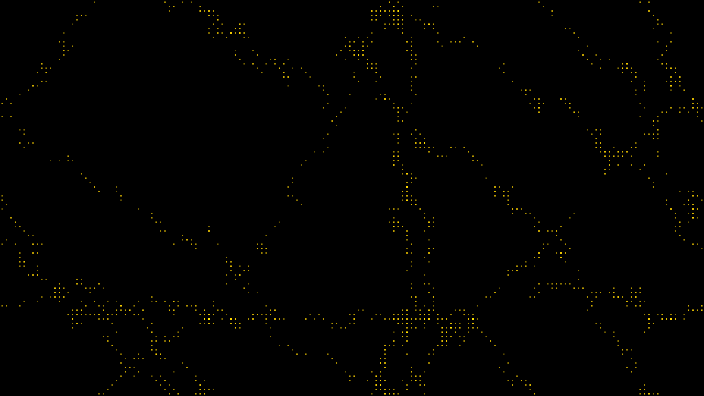

# pixels wallpaper

Pseudo-random pixel art wallpaper generator. Outputs 8K (4320 px height) images in several aspect ratios, with dot color, density and shading under your control.

The same seed and settings always produce the same image, so you can regenerate any wallpaper you like.

## Gallery

Six random-seed demos (1920×1080 previews). Each file name holds the values used to generate it.

| Preview | Seed | Color |
|---|---|---|
|  | 602 | `#39FF14` |
|  | 452 | `#FF6A00` |
|  | 211 | `#00E5FF` |
|  | 448 | `#FF2E88` |
|  | 317 | `#FFD400` |
|  | 552 | `#B388FF` |

All six use the default settings: 16:9, padding 8, density 0.55, shading min 0.45 and max 1.0.

## Requirements

- Python 3.10 or newer
- [NumPy](https://numpy.org/)
- [Pillow](https://python-pillow.org/)

```bash
pip install numpy pillow
```

## Usage

The seed and the color are required. Everything else has a default.

```bash
# Generate one 8K wallpaper
python3 wallpaper_generator.py --seed 6 --color "#39FF14"

# Choose a different aspect ratio
python3 wallpaper_generator.py --seed 6 --color "#FF6A00" --format 21:9

# Tune density and shading
python3 wallpaper_generator.py --seed 6 --color "#00E5FF" --density 0.75 --shade-min 0.2 --shade-max 0.9

# Draw the result in the terminal instead of saving a file
python3 wallpaper_generator.py --seed 6 --color "#39FF14" --preview

# Interactive menu: change seed, color, padding, format, shading and density, then confirm
python3 wallpaper_generator.py -i
```

Output files go to `output/` by default (change with `--output`). The file name holds every value needed to reproduce the image:

```
pixels_wallpaper_8K_16-9_seed6_hex39FF14_density0.55_min0.45_max1.0_padding8.png
```

### Options

| Option | Default | Description |
|---|---|---|
| `--seed N` | required | Non-negative integer. Same seed and settings give the same image. |
| `--color HEX` | required | Dot color, e.g. `#39FF14`. |
| `--padding N` | `8` | Gap inside each cell, 0 to 11. |
| `--format R` | `16:9` | `16:9`, `16:10`, `21:9`, `32:9`, `4:3`, `3:2` or `1:1`. All have 8K height (4320 px). |
| `--density X` | `0.55` | How many dots appear, 0.05 to 1.0. Higher means more dots. |
| `--shade-min X` | `0.45` | Brightness at group edges, 0 to 1. |
| `--shade-max X` | `1.0` | Brightness at group centers, 0 to 1. |
| `--output DIR` | `output/` | Output folder. |
| `--preview` | off | Show the result in the terminal (needs a terminal with 24-bit color). Saves nothing. |
| `-i`, `--interactive` | off | Menu to set everything before generating. |

Changing `--density` also changes the shape of the groups for the same seed, because the seed decides the walkers' steps and the density decides which steps light a dot.

## How it works

1. Walkers seeded from your number move across a grid of 48 px cells and light the cells they step on.
2. Each dot is drawn as a square smaller than its cell. The gap between dots is the padding.
3. Each dot's brightness depends on how many of its eight neighbors are lit. Group centers are brightest and edges dim, with some random variation per dot.

## License

- **Code:** [PolyForm Noncommercial 1.0.0](LICENSE). Free to use, copy, modify and share, but not for commercial purposes.
- **Generated images and artwork:** [Creative Commons BY-NC-SA 4.0](https://creativecommons.org/licenses/by-nc-sa/4.0/). Credit the author, don't use commercially, and share derivatives under the same license.
